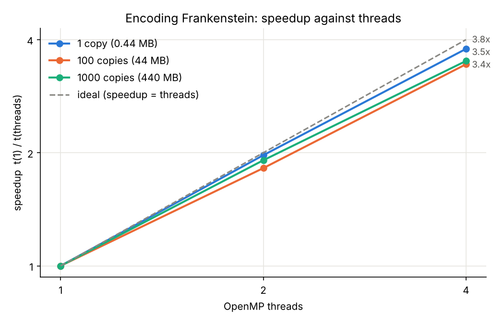

# Message Descrambling: the answers

This is the short version: what each part asks, which file solves it, and the answer. `EXPLAINED.md` is the long version, with the theory from scratch and every line of code explained.

**The secret message is:**

> You think your pain and your heartbreak are unprecedented in the history of the world, but then you read.

(It is a well-known James Baldwin quote, fitting for an exercise that ends with encoding a whole novel.)

## The files

| File | Part | What it does |
|---|---|---|
| `encoder_starter.c` | - | The sheet's original, unfinished encoder, kept for reference. |
| `encoder.c` | 1 | The finished serial encoder. Works out the length itself and adds 1 to every character. |
| `decoder.c` | 2 | Serial decoder. Subtracts 1 from every character of the scrambled text. |
| `decoder_omp.c` | 3 | OpenMP decoder. Every iteration prints the thread number and the character it decoded. |
| `read_file.h` | 4, 5 | A small helper that reads a whole file into memory using `fseek`/`ftell`. |
| `encoder_threads.c`, `decoder_threads.c` | 4 | An encoder/decoder pair that only works if both use the same number of threads. |
| `message.txt` | 4 | The plain text for the pair to encode. |
| `frankenstein_timing.c` | 5 | Encodes Frankenstein with 1, 2, 4, ... threads, times it and prints a CSV table. |
| `plot_speedup.py` | 5 | Turns those CSV tables into a speedup plot. |
| `descramble.slurm` | 1-3 | Hamilton job: runs the encoder, decoder and OpenMP decoder (1, 2, 4, 8 threads, 3 runs each). |
| `threadkey.slurm` | 4 | Hamilton job: encodes with 1, 4 and 8 threads, then decodes each with 1, 2, 3, 4, 5, 8 threads. |
| `frankenstein.slurm` | 5 | Hamilton job: a whole node, 1 to 128 threads, three text sizes, then the plot. |
| `sample_*.csv`, `sample_speedup.png` | 5 | Results from my 4-core test machine, so you know what the output looks like. **Not Hamilton numbers.** |

Every program was compiled with `gcc -O2 -Wall -Wextra -fopenmp` (no warnings) and run before I handed it over.

## Part 1: fix and finish the serial encoder

- **The missing code** is a loop that adds 1 to each character: `mymessage[i] = mymessage[i] + 1;`.
- **The length, worked out by the program:** `strlen(mymessage)` gives 105. `sizeof(mymessage) - 1` also gives 105, because `sizeof` counts the hidden `'\0'` end marker as well.
- **The fix:** the loop must stop *before* the `'\0'`. If you shift that too, it becomes byte 1, the string no longer ends, and `printf("%s")` prints garbage after the message.
- I put the real message into `mymessage`. Encoding it gives exactly the scrambled text on the sheet, and `descramble.slurm` checks that for you.

## Part 2: serial decoder

The encoder added 1, so the decoder subtracts 1 from each of the 105 characters. Every character shifts, including spaces and punctuation: `!` becomes a space, `-` becomes a comma and `/` becomes a full stop. Output: the quote at the top.

## Part 3: parallelise the decoder with OpenMP

One line does it: `#pragma omp parallel for` above the loop. This is safe, because character `i` is read and written only by the thread that owns iteration `i`, so no two threads ever touch the same byte.

**What you'll observe when you vary `OMP_NUM_THREADS`:**

1. **The final message is always correct**, whatever the thread count.
2. **The printed lines come out in a different order each run** once there are 2 or more threads. Threads run at the same time and race to the screen.
3. **Each thread gets one solid block of characters** (the default static schedule). With 4 threads: thread 0 gets characters 0-26, thread 1 gets 27-52, thread 2 gets 53-78 and thread 3 gets 79-104. 105 doesn't split evenly by 4, so thread 0 gets one extra.
4. **Inside a block the order is always kept.** Thread 2 always prints 53, 54, 55, ... in order. Only the blocks interleave with each other.
5. With few threads, each block often prints in one go, because a block of 26 characters is done before the next thread even starts. With 8 threads, the blocks get chopped up and mixed together.
6. **With more threads than characters** (try 200), only 105 threads get any work and the rest sit idle.
7. **The printing costs far more than the decoding.** Subtracting 1 takes about a nanosecond, while one `printf` takes about a microsecond, and threads take turns to write to the screen. So the parallel version is not faster here.

My 4-core test runs (each block is "thread x number of lines printed in a row"):

```
T=4 run 1: t0 x27, t1 x26, t3 x26, t2 x26
T=4 run 2: t1 x26, t3 x26, t2 x26, t0 x27
T=8 run 2: t7 x13, t3 x5, t1 x1, t6 x13, t1 x12, t2 x13, t3 x1, t0 x1, t4 x13, ...
```

## Part 4: a pair that needs the same thread count

**The idea:** let every thread use its own shift (its "key"), worked out from the thread count `T` and the thread's own number `id`:

```
key = (T + id) mod 95
```

The pair only shifts the 95 printable characters (space to `~`) and wraps around at the end, so the secret is still readable text.

- With `schedule(static)`, the same `T` always gives each thread the same block, so the decoder rebuilds exactly the same keys and undoes the shift.
- A different `T` gives different keys and different blocks, so the text comes out as garbage.

Here is the message encoded with 4 threads, then decoded with 3, 4 and 5 threads:

```
secret     : ]sy$xlmro$}syv$temr$erh$}syw%mjfwygwjfp%fwj%zsuwjhjijszkj&ot&znk&noyzux &ul&...
decode T=3 : Zpv!uijol!zpvs!qbjo!boe!zpvt"jgctvdtfbl!bsf!voqsfdfefovgf"kp"vjg"jkuvqtz!pg!...
decode T=4 : You think your pain and your heartbreak are unprecedented in the history of the world, but then you read.
decode T=5 : Xnt~sghmj~xntq~o`hm~`mb}wmsq~gd`qsaqd`j~`qd}slnpcacbclsdc~hm~sgd}fgqrmpw}md}...
```

I tested every pair of thread counts from 1 to 128 on both sides, which is 16,384 pairs. A matching pair always decodes perfectly. A mismatched pair never does: up to 47 threads it gets **no character at all** right, and even up to 128 it never gets more than 34 of 105 right.

**Its weak points:** the decoder must use the same schedule, and `OMP_DYNAMIC` must be off. Also, the OpenMP standard leaves the exact static split to each compiler, so a GCC encoder and an Intel-compiler decoder could disagree even with the same `T`.

## Part 5: time the encoder on Frankenstein and plot the speedup

**First, a warning about the sheet's `iconv` command.** Run as written, `iconv -f UTF-8 -t ASCII` stops with an error at the first curly quote or dash, and leaves a file of only **1,449 bytes** instead of the whole book. Use `iconv -f UTF-8 -t ASCII//TRANSLIT`, which turns those characters into plain ASCII. That gives 439,155 bytes. `frankenstein.slurm` does this for you.

`frankenstein_timing.c` reads the book with `fseek`/`ftell`, and can glue it to itself many times to make a bigger job. It then encodes with 1, 2, 4, ..., 128 threads. Each thread count gets a warm-up call and then many timed repeats, and the program keeps the best time. Finally it decodes the result and checks that every byte matches the original book.

`frankenstein.slurm` runs three sizes:

| Size | Bytes | What it tests |
|---|---|---|
| 1 copy | 0.44 MB | The sheet's question. Fits in cache, but one encode takes only about 0.1 ms. |
| 100 copies | 44 MB | Enough work to keep 128 threads busy. |
| 1000 copies | 440 MB | Too big for every cache on the node, so it measures memory (RAM) speed. |

**Results on my 4-core test machine (not Hamilton):**

| threads | 1 copy | 100 copies | 1000 copies |
|---|---|---|---|
| 1 | 0.112 ms, 1.00x | 23.1 ms, 1.00x | 242 ms, 1.00x |
| 2 | 1.97x | 1.82x | 1.91x |
| 4 | 3.78x | 3.44x | 3.51x |



**What I expect on Hamilton (your run will show whether it's right):**

- **1 copy:** the speedup flattens and then falls well before 128 threads. Each thread gets only about 3.4 KB, which is under a microsecond of work. Starting and stopping 128 threads costs several microseconds, so the overhead swamps the work. This is the sheet's "not sufficient to really tax" point.
- **100 and 1000 copies:** the speedup keeps rising for much longer, but stops short of 128x. The encoder does almost no arithmetic per byte, so once enough threads are running, memory bandwidth is the limit, not the cores. The `GB_per_s` column shows how close you get to the node's memory speed.

## How to run it

```bash
# on your Mac
cd ~/Documents/Durham/HPC/programs
git add openmp-descrambling
git commit -m "Descrambling exercise"
git push

# on Hamilton
ssh hamilton
cd HPC-programs && git pull        # wherever you cloned the repo
cd openmp-descrambling
sbatch descramble.slurm
sbatch threadkey.slurm
sbatch frankenstein.slurm
squeue -u $USER                    # wait until they're gone from the list
cat descramble.*.out threadkey.*.out frankenstein.*.out
```
